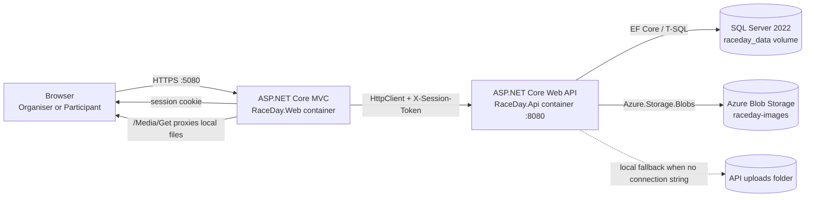

# Part 3 deployment and request flow

## Deployment view

## Container mapping

| Service | Image / Dockerfile | Host port | Container port | Notes |
|---|---|---|---|---|
| `web` | `Dockerfile` | 5080 | 8080 | MVC UI; holds server-side session only |
| `api` | `Dockerfile.api` | 5001 | 8080 | Owns all business rules, authorisation and images |
| `db` | `mcr.microsoft.com/mssql/server:2022-latest` | 1433 | 1433 | Persistent volume `raceday_data` |

Start all three with `docker compose up --build`. The web container uses `ApiSettings__BaseUrl=http://api:8080` so Docker's internal DNS resolves the API without publishing it to the browser.

## Request lifecycle

1. The browser submits a form with a Razor antiforgery token to the MVC app.
2. MVC validates the view model, then calls the API through `ApiClient` using the session token from `HttpContext.Session`.
3. The API validates the token and role, performs the EF Core operation, and returns a DTO or a structured problem response.
4. MVC converts the result into a view model, stores a short feedback message in `TempData`, and renders a Razor view with Bootstrap 5 styling.
5. Image uploads go to the API only. The API writes to Azure Blob Storage when configured, otherwise to its local development folder, then stores the returned URL on the event or user record.

## Why this satisfies the architecture requirement

- The MVC project has no `DbContext`, no entity classes and no connection string, so it cannot bypass the API.
- The MVC project has no Azure Storage packages or keys, so cloud access is isolated in the API service layer.
- Both role interfaces call the same API endpoints that Part 2's Swagger page exposes; the five Part 3 endpoints are additive and documented in `docs/api-endpoint-plan.md`.
- The API container and web container both run as a non-root user and expose only port 8080 internally.
